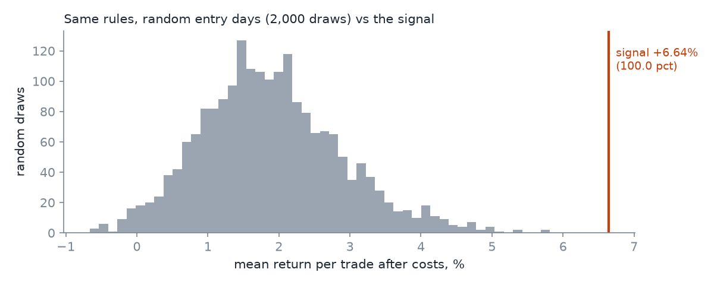

# backtest-verification-kit (한국어)

[English](README.md)

**백테스트 숫자가 진짜인지 확인하는 방법**을, 크립토·금·은·주가지수에 걸친 자동매매 포트폴리오를 실제 돈으로 운용하며 정리한 저장소입니다.
"좋은 전략을 찾았다"가 아니라 **"검증을 어떻게 하는가"** 가 주제입니다. 실제 운용 전략·파라미터·계좌는 넣지 않았고, 예시 전략은 교과서식 돈치안 돌파입니다.

## 30초 요약

1. **신호는 하나, 규칙은 여러 벌.** 같은 신호를 규칙이 다른 프랍 회사 세 곳의 평가 계좌에서 운용해 왔습니다. 기대 금액을 가장 크게 바꾼 변화 상당수는 더 좋은 신호가 아니라 **규칙을 정확히 모델링한 것**에서 나왔습니다.
   예: 귀금속 동시 보유를 2종으로 묶었더니 한도를 넘는 날이 1 → 0, 기대 금액 +16~66%.
2. **좋아 보이는 숫자는 대개 측정 버그였습니다.** 결과를 부풀린 버그 11건을 오차 크기, 그리고 지금 그것을 막는 규칙과 함께 기록했습니다.
   예: 거래당 +0.44%로 보이던 전략이 실제로는 −0.91%.
3. **실거래 비용을 매주 잽니다.** 주문 106건 왕복 비용 7.7bp로, 백테스트 가정(11bp) 안입니다.
4. **한 사람이 작은 트레이딩 회사처럼 운영합니다.** 컨테이너 약 30개, 예약 작업 약 40개, 실행처 두 종류, 감시 5겹, 바뀐 서비스를 주문 없이 시험한 뒤에만 승인하는 원커맨드 배포. 실제 운영 모듈 4개를 검사와 함께 넣었습니다. ([시스템 구조](docs/ko/ARCHITECTURE.md))

회색은 진입 날짜만 무작위로 바꿔 2,000번 돌린 결과, 빨간 선은 실제 신호입니다. 빨간 선이 회색 분포 밖에 있으면 우연이 아니라는 뜻입니다.

## 읽는 순서

0. **[실제 운영 시스템 구조](docs/ko/ARCHITECTURE.md)**: 전체 시스템이 어떻게 생겼고, 각 부분이 어떤 사고 때문에 생겼는지 (3분)
1. **[계좌별 규칙 대응](docs/ko/CONSTRAINTS.md)**: 프랍 평가 계좌가 어떻게 돌아가는지, 회사별 규칙을 어떻게 모델링했고 결과가 어땠는지 (5분)
2. **[측정 버그 11건](docs/ko/INCIDENTS.md)**: 무엇이 좋아 보였고, 실제로 뭐가 틀렸고, 얼마나 틀렸는지 (5분)
3. [같은 봉 체결+손절 해설](docs/DEEP_DIVE_same_bar.md) (영어): 버그 하나를 코드 수준으로
4. [실거래 비용 보고 샘플](docs/SAMPLE_LIVE_REPORT.md) (영어): 주문 유형별 수수료·슬리피지

코드(`verify/`, `tests/`)는 위 내용을 실제로 돌려 볼 수 있게 만든 부분입니다.

| 코드 | 하는 일 |
|---|---|
| `verify/spec.py` | 모든 설정값을 한 파일에. 아직 못 고친 낙관 요인 목록도 같이 둠 |
| `verify/backtest.py` | 시뮬레이터는 하나. 한 봉 안에서 체결 먼저·손절 나중, 갭 손절은 시가 체결 |
| `verify/null.py` | 무작위 진입 대조군 |
| `verify/ev.py` | 3년 기대 자산 (블록 부트스트랩, 최고의 하루 제외 포함) |
| `verify/walkforward.py` | 워크포워드: 과거 데이터만으로 파라미터를 고르고 다음 해에 평가 |
| `verify/exec_quality.py` | 실거래 비용 측정 (손절은 트리거 가격 기준) |
| `production/` | **실제 운영 모듈**: 메이커 우선 청산, 실행비용 측정, 성과 차이 분해, 실거래↔백테스트 건너뜀 점검 (주석만 영어, 로직 동일) |
| `tests/` | 버그 하나에 검사 하나, 운영 모듈 검사 포함 (올릴 때마다 GitHub에서 자동 실행) |

## 한계

* 문서의 백테스트 숫자는 전부 인샘플입니다. 계획에 쓸 때는 워크포워드 비율로 깎았고, 시도 횟수를 감안하면 샤프 중 운이 아닌 몫은 30~50% 정도로 봅니다.
* 실거래 기록은 아직 짧습니다(2026년 8월부터). 몇 달로는 약한 엣지와 나쁜 구간을 구별할 수 없습니다.
* 투자 조언이 아닙니다.

## 만든 사람

**노원석 (Wonseok Roh)** · 숭실대학교 · 위 시스템을 설계하고 운영하고 있습니다.
퀀트 리서치, 트레이딩 인프라, 데이터 엔지니어링 인턴 기회를 찾고 있습니다. GitHub [@Wonscoldin](https://github.com/Wonscoldin)
