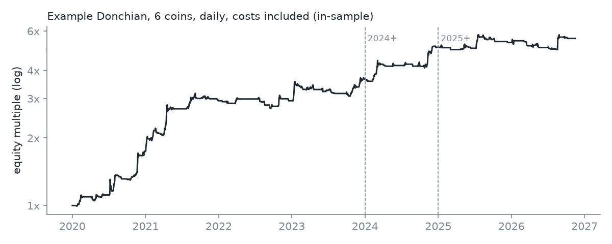

# backtest-verification-kit

[](https://github.com/Wonscoldin/backtest-verification-kit/actions/workflows/tests.yml)

**How I check that a backtest is telling the truth** — distilled from running a live, fully automated
multi-strategy, multi-asset portfolio (crypto, gold, silver, equity indices).

This repository is about *verification*, not about an edge. The example strategy is a textbook
Donchian breakout on public Binance data; my live strategies, parameters and accounts are not here.
It was extracted from a private operations repository, so the history here is short.


```
public data ──► canonical run() ──► random-entry null ──► EV by window ──► walk-forward ──► live vs backtest
 (verify/data)   (verify/backtest)     (verify/null)        (verify/ev)    (verify/walkforward) (verify/exec_quality)
                        ▲
                 verify/spec.py  (the only place constants live)
```

## Start here

1. **[docs/INCIDENTS.md](docs/INCIDENTS.md)** — eleven measurement bugs that made results look better than they were, how large each error was, and the rule that now prevents it.
2. **[docs/DEEP_DIVE_same_bar.md](docs/DEEP_DIVE_same_bar.md)** — one of them in detail: the trade that fills and is stopped in the same bar (+0.44% → −0.91% per trade).
3. **[docs/SAMPLE_LIVE_REPORT.md](docs/SAMPLE_LIVE_REPORT.md)** — what the live execution-cost report looks like (7.7bp round trip vs 11bp assumed).

## What is in here

| Piece | Why it exists |
|---|---|
| `verify/spec.py` | Every constant in one file, plus `KNOWN_OPTIMISM` — the biases not yet corrected, quoted with every number. |
| `verify/backtest.py` | One simulator. Bar-order rules: signal on close → fill next bar; **fill before stop inside a bar**; gap stops fill at the open; fixed same-day order. |
| `verify/null.py` | Random-entry null that shares every rule except *when* to enter. Gates are percentiles against it. |
| `verify/ev.py` | Expected wealth over 3 years (20-day block bootstrap, a Monte Carlo over return blocks), per window, and with the best day removed. |
| `verify/walkforward.py` | Anchored walk-forward: parameters chosen only with past data, scored by EV; reports the out-of-sample / in-sample ratio and flags choices on the grid edge. |
| `verify/exec_quality.py` | Live cost vs the backtest assumption — with the reference-price rules that once turned an 8bp cost into a fake 15bp. |
| `docs/PREREG_TEMPLATE.md` | Criteria are fixed before measuring; every attempt is counted. |
| `tests/` | Each test locks a rule whose violation once inflated a real result (bar order, gap fills, look-ahead, null sampling, causality of walk-forward slicing). |

## Run it

```bash
pip install -r requirements.txt
python -m pytest -q                       # offline, synthetic data
python -m examples.run_example            # downloads public daily bars (no API key)
python -m examples.walkforward_example    # 12-cell grid, test years 2022-2026
python -m examples.same_bar_demo          # incident #3 on public data
python -m examples.make_figures           # regenerates docs/img
```

Example output (in-sample, includes the 2020–21 bull market — not a performance claim):

```
CAGR 28.4% | MDD -14.4% | trades 304
Random-entry null: actual +6.64%/trade vs null +1.87 +/- 0.99 -> 100.0 percentile
3-year EV: all 2.26x | 2024+ 1.63x | 2025+ 1.17x  (best day removed: 2.13 / 1.52 / 1.04)
Walk-forward (2022-2026): out-of-sample CAGR 19.0% vs in-sample best 19.3% -> ratio 0.98 (grid edge: a bound)
```



Read it the way the kit intends: the signal clearly beats random entry with the same rules and its parameters
are not over-fitted (walk-forward ratio ≈ 1), but the edge shrinks sharply in recent windows and the 2025+
result mostly depends on a few days. That is the kind of sentence a verification step should produce.

## The live system this comes from (not included)

* Several strategies across crypto perpetuals and gold/index markets, running unattended on two servers that watch each other.
* Part of it on funded-trader evaluation accounts (prop-firm style) with hard daily and total loss limits checked intraday — which is why the backtest reports a **pass rate** next to returns ([context](docs/INCIDENTS.md#context-what-pass-rate-means-here)).
* Daily live-vs-backtest parity check: every skipped signal must carry a reason the backtest knows.
* Weekly execution-cost and implementation-shortfall reports.
* A research ledger of 70+ rejected strategy families, a pre-registration budget, and a research moratorium when results started driving too many changes.

## Author

노원석 · Soongsil University · built and operates the system above on my own.
Open to internships in quant research, trading infrastructure or data engineering.
GitHub [@Wonscoldin](https://github.com/Wonscoldin)

---

## 한국어 요약

**백테스트가 진짜인지 검증하는 방법**을, 크립토·금·은·주가지수에 걸친 멀티에셋 자동매매 포트폴리오를 실제로 운영하며 정리한 저장소입니다.
전략 자체(엣지)가 아니라 **검증 절차**가 주제입니다. 예시 전략은 교과서식 돈치안 돌파이고, 실제 운용 전략·파라미터·계좌는 포함하지 않습니다. 비공개 운영 저장소에서 검증 부분만 추려 공개했습니다.

- **하나의 정본 시뮬레이터**: 설정은 `spec.py` 한 곳, 변형은 `run()` 인자로만.
- **봉 안 순서 규칙**: 체결이 먼저, 손절이 나중. 갭 손절은 시가 체결.
- **무작위 진입 귀무**: 진입 시점만 무작위로 바꾸고 나머지 규칙은 같게 해서 백분위로 판정.
- **기대 자산(EV)**: 블록 부트스트랩, 세 구간 + 최고의 하루 제외.
- **워크포워드**: 과거 데이터만으로 파라미터를 고르고, 표본 밖/표본 안 비율로 낙관을 깎음.
- **실행비용 실측**: 손절은 트리거 가격 기준으로 슬리피지 측정 (실거래 왕복 7.7bp vs 가정 11bp).
- **통과율**: 일부는 하루·전체 손실 한도가 장중 기준으로 걸린 펀디드 트레이더 평가 계좌(프랍)에서 운용합니다. 한도를 한 번이라도 넘으면 계좌가 끝나기 때문에, 수익률 옆에 '그 경로가 한도에 안 닿을 확률'을 같이 잽니다.
- **사고 기록 11건** (`docs/INCIDENTS.md`): 결과를 부풀린 측정 버그와 오차 크기, 재발 방지 규칙.

License: MIT
