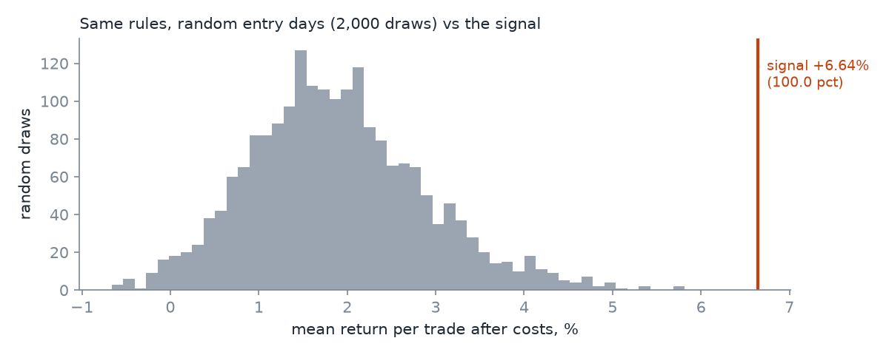

# backtest-verification-kit

[](https://github.com/Wonscoldin/backtest-verification-kit/actions/workflows/tests.yml) · [한국어](README.ko.md)

**How I check that a backtest is telling the truth** — distilled from running a live, fully automated
multi-strategy, multi-asset portfolio (crypto, gold, silver, equity indices).

This repository is about *verification*, not about an edge. The example strategy is a textbook
Donchian breakout on public Binance data; my live strategies, parameters and accounts are not here.
It was extracted from a private operations repository, so the history here is short.

## In 30 seconds

1. **One signal, several rulebooks.** The same signals run on evaluation accounts at three prop firms with different rules. Modelling the rules correctly moved expected money more than better signals did — e.g. capping correlated metals at two: breach days 1 → 0, EV +16–66%. ([details](docs/CONSTRAINTS.md))
2. **A good-looking number is usually a measurement bug.** Eleven bugs that inflated results, each with its error size and a test that fails if it returns — e.g. +0.44% per trade that was really −0.91%. ([details](docs/INCIDENTS.md))
3. **Live costs are measured every week.** 106 orders, 7.7bp round trip vs 11bp assumed in the backtest. ([details](docs/SAMPLE_LIVE_REPORT.md))



```
public data ──► canonical run() ──► random-entry null ──► EV by window ──► walk-forward ──► live vs backtest
 (verify/data)   (verify/backtest)     (verify/null)        (verify/ev)    (verify/walkforward) (verify/exec_quality)
                        ▲
                 verify/spec.py  (the only place constants live)
```

## Start here

1. **[docs/CONSTRAINTS.md](docs/CONSTRAINTS.md)** — one signal, several rulebooks: how prop-firm evaluation accounts work, and how each firm's rules (intraday loss limits, swap, spread caps, weekend closures, opposite-position rules) were modelled and decided by expected money.
2. **[docs/INCIDENTS.md](docs/INCIDENTS.md)** — eleven measurement bugs that made results look better than they were, how large each error was, and the rule that now prevents it.
3. **[docs/DEEP_DIVE_same_bar.md](docs/DEEP_DIVE_same_bar.md)** — one of them in detail: the trade that fills and is stopped in the same bar (+0.44% → −0.91% per trade).
4. **[docs/SAMPLE_LIVE_REPORT.md](docs/SAMPLE_LIVE_REPORT.md)** — what the live execution-cost report looks like (7.7bp round trip vs 11bp assumed).

## What is in here

| Piece | Why it exists |
|---|---|
| `verify/spec.py` | Every constant in one file, plus `KNOWN_OPTIMISM` — the biases not yet corrected, quoted with every number. |
| `verify/backtest.py` | One simulator. Bar-order rules: signal on close → fill next bar; **fill before stop inside a bar**; gap stops fill at the open; fixed same-day order. |
| `verify/null.py` | Random-entry null that shares every rule except *when* to enter. Gates are percentiles against it. |
| `verify/ev.py` | Expected wealth over 3 years (20-day block bootstrap, a Monte Carlo over return blocks), per window, and with the best day removed. |
| `verify/walkforward.py` | Anchored walk-forward: parameters chosen only with past data, scored by EV; reports the out-of-sample / in-sample ratio and flags choices on the grid edge. |
| `verify/exec_quality.py` | Live cost vs the backtest assumption — with the reference-price rules that once turned an 8bp cost into a fake 15bp. |
| `docs/PREREG_TEMPLATE.md` | Criteria are fixed before measuring; every attempt is counted. |
| `tests/` | Each test locks a rule whose violation once inflated a real result (bar order, gap fills, look-ahead, null sampling, causality of walk-forward slicing). |

## Run it

```bash
pip install -r requirements.txt
python -m pytest -q                       # offline, synthetic data
python -m examples.run_example            # downloads public daily bars (no API key)
python -m examples.walkforward_example    # 12-cell grid, test years 2022-2026
python -m examples.same_bar_demo          # incident #3 on public data
python -m examples.make_figures           # regenerates docs/img
```

Example output (in-sample, includes the 2020–21 bull market — not a performance claim):

```
CAGR 28.4% | MDD -14.4% | trades 304
Random-entry null: actual +6.64%/trade vs null +1.87 +/- 0.99 -> 100.0 percentile
3-year EV: all 2.26x | 2024+ 1.63x | 2025+ 1.17x  (best day removed: 2.13 / 1.52 / 1.04)
Walk-forward (2022-2026): out-of-sample CAGR 19.0% vs in-sample best 19.3% -> ratio 0.98 (grid edge: a bound)
```


Read it the way the kit intends: the signal clearly beats random entry with the same rules and its parameters
are not over-fitted (walk-forward ratio ≈ 1), but the edge shrinks sharply in recent windows and the 2025+
result mostly depends on a few days. That is the kind of sentence a verification step should produce.

## The live system this comes from (not included)

* Several strategies across crypto perpetuals and gold/index markets, running unattended on two servers that watch each other.
* Part of it on funded-trader evaluation accounts (prop-firm style) with hard daily and total loss limits checked intraday — which is why the backtest reports a **pass rate** next to returns ([context](docs/INCIDENTS.md#context-what-pass-rate-means-here)).
* Daily live-vs-backtest parity check: every skipped signal must carry a reason the backtest knows.
* Weekly execution-cost and implementation-shortfall reports.
* A research ledger of 70+ rejected strategy families, a pre-registration budget, and a research moratorium when results started driving too many changes.

## Limitations

* Every backtest number in these docs is **in-sample**. Planning values were discounted by walk-forward ratios, and the
  share of the Sharpe ratio that is not luck was estimated with a deflated-Sharpe haircut over all attempts (roughly 30–50%).
* The live track record is short (live since August 2026); a few months cannot separate a weak edge from a bad stretch.
* The example strategy uses today's coin list (survivorship) and daily bars; see `KNOWN_OPTIMISM` in `verify/spec.py`.
* Nothing here is investment advice.

## Author

**Wonseok Roh (노원석)** · Soongsil University · built and operates the system above on my own.
Open to internships in quant research, trading infrastructure or data engineering.
GitHub [@Wonscoldin](https://github.com/Wonscoldin)

---

한국어판 전체: [README.ko.md](README.ko.md)

License: MIT
